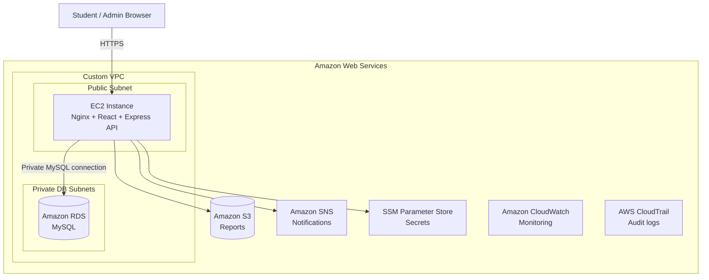

<div align="center">

# 🪙 PennyPal
### Little Money. Big Lessons.

**A virtual banking and financial literacy platform for young learners.**

[](https://react.dev/)
[](https://nodejs.org/)
[](https://www.mysql.com/)
[](https://www.docker.com/)
[](https://aws.amazon.com/)

**[Live Demo](https://3.111.214.53.nip.io/)** · **[Quick Start](#-run-locally-with-docker)** · **[Architecture](#-aws-cloud-architecture)**

</div>

---

## 🌟 Overview

**PennyPal** makes financial education approachable through a simulated banking experience. Students can practice managing virtual money and develop financial awareness in a safe, educational environment—without handling real funds.

The project combines a React web application, an Express API, MySQL persistence, Docker Compose for local deployment, and an AWS-hosted environment demonstrating practical cloud engineering.

> **Educational simulation:** PennyPal is not a real bank, payment processor, or financial service. No real money is transferred.

## ✨ Highlights

- 🏦 **Virtual banking experience** — practice managing money in a simulated environment.
- 👩‍🎓 **Student experience** — a dedicated dashboard for young learners.
- 🧠 **Financial literacy quizzes** — a seeded question bank containing 33 questions.
- 🛡️ **Account authentication** — backend-managed user accounts and authentication.
- 📊 **Admin access** — administrative account support.
- 🐳 **One-command local deployment** — frontend, API, and MySQL with Docker Compose.
- ☁️ **AWS deployment** — a working cloud architecture with private database networking and managed services.

## 🧰 Tech Stack

| Layer | Technology |
|---|---|
| Frontend | React, Vite |
| Backend | Node.js, Express |
| Database | MySQL 8 |
| Web server / reverse proxy | Nginx |
| Containers | Docker, Docker Compose |
| Cloud hosting | Amazon EC2, Amazon VPC |
| Managed database | Amazon RDS for MySQL |
| Object storage | Amazon S3 |
| Notifications | Amazon SNS |
| Configuration | AWS Systems Manager Parameter Store |
| Observability and governance | Amazon CloudWatch, AWS CloudTrail, AWS Budgets |

## 🏗️ AWS Cloud Architecture



**Deployment notes:** The production environment runs in the AWS Mumbai Region (`ap-south-1`). The database is hosted in private subnets; the EC2-hosted application accesses AWS services using its IAM role. S3 buckets are private, and application secrets are not stored in this repository.

## 🐳 Run Locally with Docker

### Prerequisites

- Docker Desktop with Docker Compose enabled
- Git (optional, for cloning)

### 1. Clone the repository

```bash
git clone https://github.com/riyaadsilva/pennypal-cloud-banking.git
cd pennypal-cloud-banking
```

Replace `YOUR_USERNAME` with your GitHub username after publishing.

### 2. Configure local secrets

Create a `.env` file in the project root with **three different, strong, randomly generated secrets**:

```dotenv
MYSQL_ROOT_PASSWORD=replace-with-strong-random-secret
MYSQL_PASSWORD=replace-with-a-different-strong-random-secret
JWT_SECRET=replace-with-a-long-random-secret
```

Do **not** commit `.env` or reuse production AWS credentials. The local Docker deployment uses its own MySQL database.

### 3. Start the database

```bash
docker compose up -d db
```

Wait until the database is healthy:

```bash
docker compose ps
```

### 4. Apply migrations and seed demo data

```bash
docker compose run --rm --build backend node src/db/migrate.js
docker compose run --rm backend node src/db/seed.js
```

The seed script initializes a demo student, an admin account, and the financial literacy question bank. Consult the seed script for the intended local demonstration credentials; change any default credentials before exposing the application beyond your machine.

### 5. Start the full application

```bash
docker compose up -d --build
```

Open **http://localhost:8080**.

### 6. Stop the application

```bash
docker compose down
```

To **delete local database data as well**, run `docker compose down -v` only when you intentionally want to remove the MySQL volume.

## 📁 Project Structure

```text
pennypal/
├── client/               # React / Vite frontend, Nginx configuration
├── server/               # Express API and database scripts
├── database/
│   └── migrations/       # SQL schema migrations
├── infrastructure/       # Cloud infrastructure-related project files
├── docs/                 # Project documentation
├── compose.yaml          # Local multi-container deployment
├── .env.example          # Example application environment configuration
└── README.md
```

## 🔐 Security Considerations

- **Keep credentials out of Git.** Never commit `.env`, private keys, database passwords, JWT secrets, or AWS access keys.
- **Private database networking.** Production RDS is hosted in private subnets, not exposed directly to the internet.
- **AWS IAM roles.** Use instance roles and least-privilege permissions instead of hard-coded cloud credentials.
- **Encrypted configuration.** Sensitive production configuration can be stored in Systems Manager Parameter Store using SecureString.
- **Private object storage.** S3 Block Public Access is enabled for the application's report bucket.
- **Local-only published port.** Docker Compose publishes the frontend on `127.0.0.1:8080` for local development.

> Before publishing, review `infrastructure/`, `docs/`, configuration files, and Git history for secrets or account-specific information. `.gitignore` alone does not protect secrets already committed.

## 🚀 Deployment Modes

| Environment | Application | Database | Entry point |
|---|---|---|---|
| Local | React + Nginx + Express containers | MySQL container | `http://localhost:8080` |
| AWS | EC2-hosted Nginx + React + Express | Amazon RDS MySQL | [Live demo](https://3.111.214.53.nip.io/) |

The local Compose environment does not automatically reproduce AWS IAM roles, SNS notifications, S3 report storage, or SSM configuration. Those features require suitable AWS integration and permissions.

## 🎓 Learning Outcomes

PennyPal demonstrates full-stack application development, relational database migrations, containerization, reverse proxy configuration, AWS networking, managed databases, cloud security, observability, and deployment troubleshooting.

## 📌 Project Status

- [x] React frontend and Express backend
- [x] MySQL database migrations and demo seed data
- [x] Docker Compose local deployment
- [x] AWS-hosted production deployment
- [ ] GitHub repository publication

---

<div align="center">

**PennyPal — Learn to earn, save, and spend wisely.** 💛

*Built as an educational full-stack and cloud computing project.*

</div>
