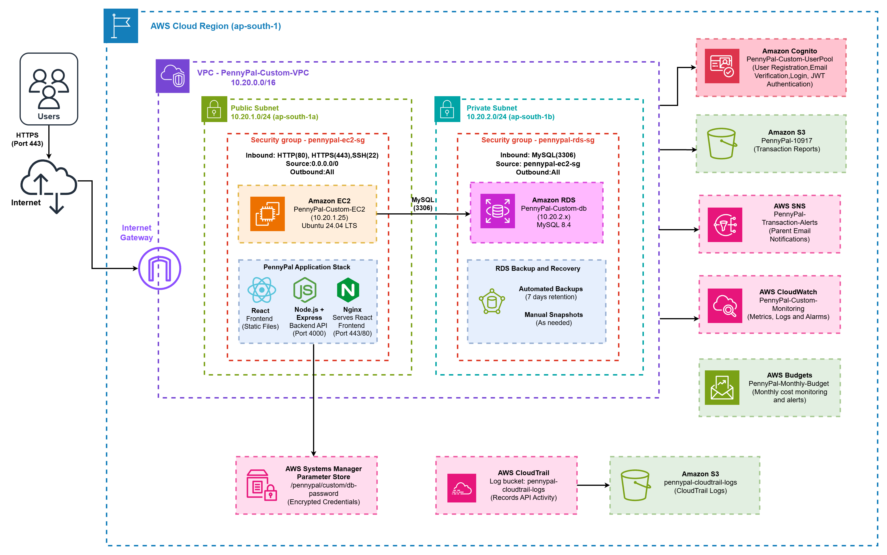

# PennyPal

### Little Money. Big Lessons.

**A cloud-based virtual banking and financial literacy platform for young learners.**

[](https://react.dev/)
[](https://nodejs.org/)
[](https://www.mysql.com/)
[](https://www.docker.com/)
[](https://aws.amazon.com/)

**[Live Demo](https://3.111.214.53.nip.io/)** | **[AWS Architecture](#aws-cloud-architecture)** | **[Local Setup](#run-locally-with-docker)**

---

## Overview

**PennyPal** is an educational virtual banking platform designed to help young learners understand money management through practical, interactive experiences.

Students can manage virtual balances, perform simulated transactions, set savings goals, complete financial literacy quizzes, and earn achievements.

The platform is developed using React, Node.js, Express, and MySQL, and integrates multiple Amazon Web Services to demonstrate cloud application development, security, monitoring, and deployment.

> **Disclaimer:** PennyPal is an educational simulation. It does not process real payments or transfer actual money.

## Key Features

- **Virtual Banking:** Simulated deposits, withdrawals, balances, and transaction history.
- **Savings Goals:** Create and track financial savings targets.
- **Financial Literacy:** Interactive quizzes with a seeded question bank of 33 questions.
- **Gamification:** Experience points, achievements, and learning streaks.
- **Amazon Cognito Authentication:** User identity management and token-based authentication.
- **Parent Notifications:** Amazon SNS integration for transaction-related email notifications.
- **Transaction Reports:** Amazon S3 integration for report storage.
- **Student Dashboard:** Personalized financial activity and learning progress.
- **Administrative Support:** Application administration and management capabilities.
- **Cloud Monitoring:** CloudWatch monitoring and alarms.

## Technology Stack

| Layer | Technology |
|---|---|
| Frontend | React.js, Vite |
| Backend | Node.js, Express.js |
| Database | MySQL 8, Amazon RDS |
| Authentication | Amazon Cognito |
| Hosting | Amazon EC2 |
| Networking | Amazon VPC, Subnets, Security Groups |
| Reverse Proxy | Nginx |
| Object Storage | Amazon S3 |
| Notifications | Amazon SNS |
| Configuration Management | AWS Systems Manager Parameter Store |
| Monitoring | Amazon CloudWatch |
| Cloud Auditing | AWS CloudTrail |
| Cost Management | AWS Budgets |
| Containerization | Docker, Docker Compose |
| Version Control | Git, GitHub |
| Continuous Integration | GitHub Actions |

## AWS Cloud Architecture

PennyPal is deployed on Amazon Web Services in the **Asia Pacific (Mumbai) Region (`ap-south-1`)**.

The architecture combines compute, managed database services, networking, identity management, storage, notifications, and monitoring.



**[View Original AWS Architecture Diagram](https://drive.google.com/file/d/1c9Ue67BQbCpofLytnE_WuGa5iaGy3I5B/view?usp=sharing)**

### AWS Services and Their Roles

| AWS Service | Purpose |
|---|---|
| Amazon EC2 | Hosts the frontend and backend application |
| Amazon VPC | Provides network isolation and controlled connectivity |
| Amazon RDS | Hosts the managed MySQL database |
| Amazon Cognito | Handles user authentication and identity |
| Amazon S3 | Stores application-generated reports |
| Amazon SNS | Sends parent email notifications |
| AWS IAM | Manages service permissions and access |
| Systems Manager Parameter Store | Manages sensitive application configuration |
| Amazon CloudWatch | Collects monitoring metrics and supports alarms |
| AWS CloudTrail | Records AWS API activity |
| AWS Budgets | Tracks cloud expenditure and budget thresholds |

### Application Data Flow

1. A user accesses the PennyPal application through a web browser.
2. Nginx serves the React frontend and forwards API requests to Express.
3. Amazon Cognito provides authentication and identity verification.
4. The backend processes authorized application requests.
5. Amazon RDS stores application data, transactions, savings goals, and quiz records.
6. Amazon SNS supports parent transaction notifications.
7. Amazon S3 stores generated reports.
8. CloudWatch monitors the infrastructure and application environment.

The application uses IAM permissions and environment-specific configuration to access AWS resources.

## Project Structure

```text
pennypal/
├── .github/
│   └── workflows/
│       └── ci.yml
├── client/
│   ├── src/
│   │   ├── components/
│   │   ├── config/
│   │   ├── context/
│   │   ├── pages/
│   │   └── services/
│   └── Dockerfile
├── server/
│   ├── src/
│   │   ├── db/
│   │   ├── middleware/
│   │   ├── routes/
│   │   └── services/
│   └── Dockerfile
├── database/
│   └── migrations/
├── infrastructure/
├── docs/
│   └── aws-architecture.png
├── compose.yaml
├── .env.example
└── README.md
```

## Run Locally with Docker

### Prerequisites

- Docker Desktop
- Docker Compose
- Git

### 1. Clone the Repository

```bash
git clone https://github.com/riyaadsilva/pennypal-cloud-banking.git
cd pennypal-cloud-banking
```

### 2. Configure Environment Variables

Create a `.env` file using the provided `.env.example` as a reference.

For the local Docker environment, configure the required MySQL and application secrets.

```dotenv
MYSQL_ROOT_PASSWORD=replace-with-strong-random-secret
MYSQL_PASSWORD=replace-with-a-different-strong-random-secret
JWT_SECRET=replace-with-a-long-random-secret
```

Cognito, SNS, S3, and other AWS integrations require additional environment-specific configuration and permissions.

Never commit real credentials, access keys, or production secrets.

### 3. Start MySQL

```bash
docker compose up -d db
docker compose ps
```

Wait for the database to become healthy.

### 4. Apply Database Migrations

```bash
docker compose run --rm --build backend node src/db/migrate.js
```

### 5. Seed Demo Data

```bash
docker compose run --rm backend node src/db/seed.js
```

### 6. Start the Application

```bash
docker compose up -d --build
```

Open the local application at:

**http://localhost:8080**

### 7. Stop the Application

```bash
docker compose down
```

The local environment may require additional configuration to use Cognito or other AWS-integrated functionality.

## Continuous Integration

PennyPal uses **GitHub Actions** for automated build verification.

The CI workflow is defined in:

`.github/workflows/ci.yml`

It performs the following operations:

1. Checks out the repository.
2. Configures Node.js.
3. Installs frontend dependencies using `npm ci`.
4. Builds the React frontend.
5. Installs backend dependencies.
6. Validates backend JavaScript syntax.
7. Builds the frontend Docker image.
8. Builds the backend Docker image.

The workflow runs on pushes to `main`, pull requests targeting `main`, and manual dispatch.

Docker images are built for verification and are not automatically pushed or deployed by this workflow.

## Security

PennyPal incorporates several cloud security practices:

- Amazon Cognito for identity and authentication.
- JWT verification for protected API operations.
- IAM-based permissions for AWS resource access.
- Private database networking.
- Environment-based application configuration.
- Systems Manager Parameter Store integration.
- Private S3 storage.
- Security groups controlling network access.
- CloudWatch monitoring and alarms.

Sensitive configuration and private keys must never be committed to the repository.

**Security note:** Dependency audits and application security testing should be completed before production releases.

## Deployment Environments

| Environment | Application | Database |
|---|---|---|
| Local Development | Docker Compose, React, Express, Nginx | MySQL container |
| AWS Deployment | Amazon EC2, React, Express, Nginx | Amazon RDS MySQL |

**Live Application:** https://3.111.214.53.nip.io/

## Learning Outcomes

This project demonstrates:

- Full-stack application development
- REST API design
- Relational database management
- Cloud infrastructure and networking
- Authentication and authorization
- AWS service integration
- Secure configuration management
- Containerization and Docker deployment
- Continuous integration using GitHub Actions
- Cloud monitoring and cost awareness

---

**PennyPal — Little Money. Big Lessons.**

*An educational cloud computing and full-stack development project.*